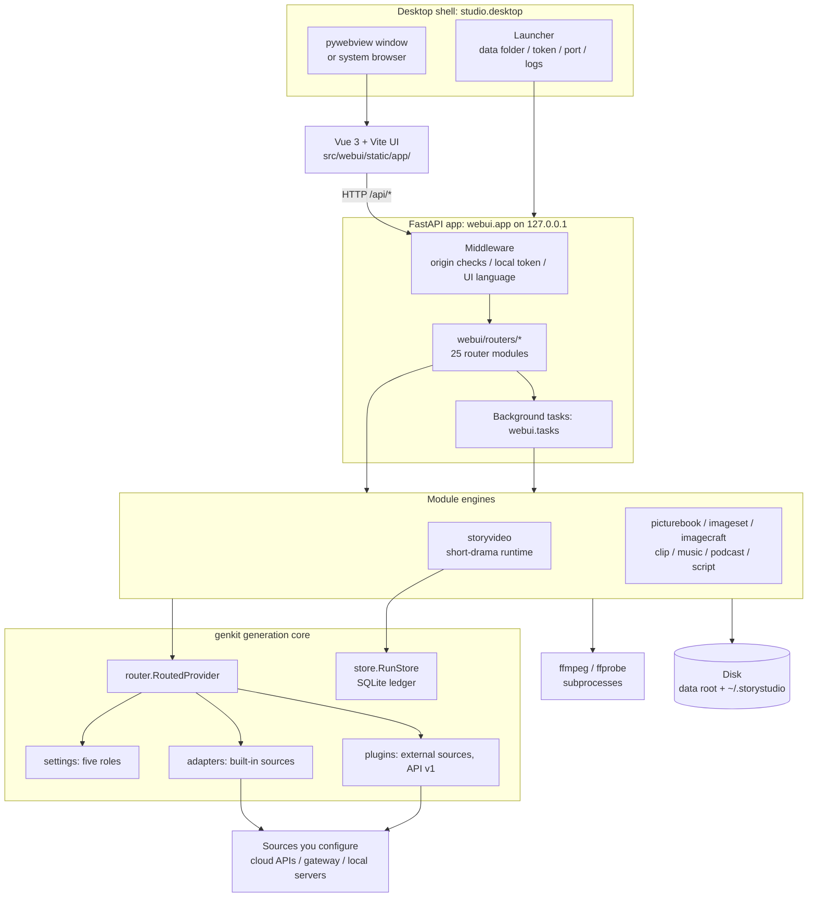
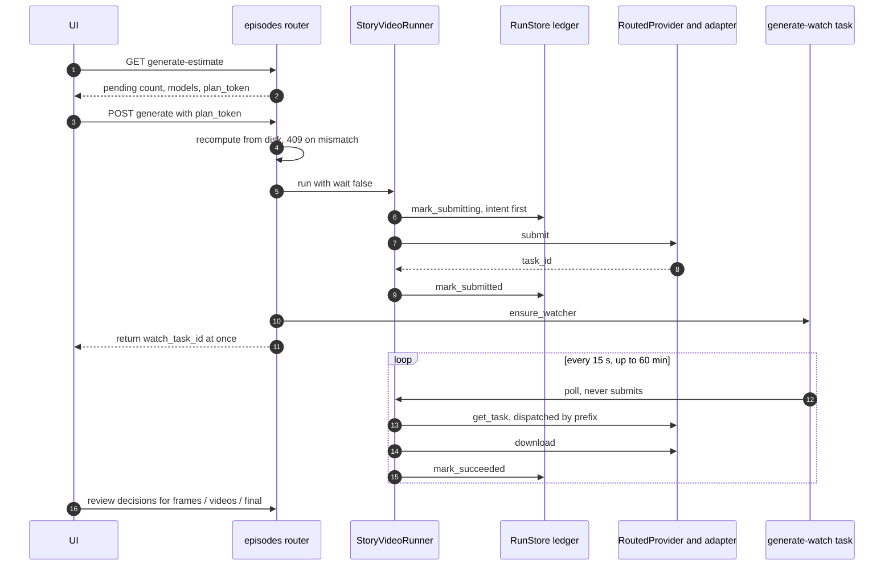

English | [中文](../zh/architecture.md)

# Technical architecture

This document explains how Content Cook is put together: processes and layers, a map of the source tree,
what happens between clicking "generate" and a file landing on disk, how data is stored, how model
providers are abstracted, how prompts are compiled, how media is rendered, and how security,
packaging and testing work.

- To get the app running first, see [Installation and deployment](installation.md).
- For the reasoning behind the design, see [Design and features](design.md).
- For settings and environment variables, see [Configuration reference](configuration.md).
- For an index of all documentation, see [docs/README.md](../README.md).

This describes the code at v0.1.0. The per-layer table in [ARCHITECTURE.md](../../ARCHITECTURE.md)
and the numbered design log in [DESIGN.md](../../DESIGN.md) go deeper (both are in Chinese).

> **A note on names**: the product is **Content Cook · Content creation workbench**, and its only source
> is `src/webui/branding.py`. The pip distribution (`name` in `pyproject.toml`) is `storystudio`, the commands are
> `storystudio` and `storyvideo`, the importable Python packages are `genkit`, `storyvideo`, `webui`, `studio` and so on
> (see [section 2](#2-source-map)), the desktop program is `StoryStudio.exe`, and the settings folder is `~/.storystudio`.
> These are technical identifiers and deliberately don't follow the product name. To rename the product, change the
> constants in `branding.py` and update the copies elsewhere: the default `AppName` in `desktop/installer.iss`, the
> fallback literals in `desktop/storystudio.spec` and `src/studio/desktop.py`, and the title of the older page
> `src/webui/static/index.html`. `tests/test_packaging_files.py` checks the installer, spec and older-page copies.

## Contents

1. [Overview](#1-overview)
2. [Source map](#2-source-map)
3. [Startup sequence](#3-startup-sequence)
4. [Lifecycle of a paid generation](#4-lifecycle-of-a-paid-generation)
5. [Persistence](#5-persistence)
6. [Background tasks and resuming](#6-background-tasks-and-resuming)
7. [Model provider abstraction](#7-model-provider-abstraction)
8. [Prompt compilation](#8-prompt-compilation)
9. [Media pipeline](#9-media-pipeline)
10. [UI languages](#10-ui-languages)
11. [Security architecture](#11-security-architecture)
12. [Packaging architecture](#12-packaging-architecture)
13. [Testing strategy](#13-testing-strategy)
14. [Further reading](#14-further-reading)

## 1. Overview

Content Cook is a single-user program that runs on your own machine. One Python process hosts a FastAPI
server bound to `127.0.0.1`. The UI is a Vue single-page app shown in a native window (pywebview) or your
system browser, and it talks to the backend over HTTP only. When content is generated, the backend calls
whatever sources you configured under "Model settings": cloud APIs, a unified gateway, or inference servers
running locally. Joining, subtitles and mixing happen locally with ffmpeg. Projects and outputs stay on your disk.



A few rules hold everywhere:

- **The UI only speaks HTTP.** It doesn't rely on a JS bridge from the desktop shell, and all business rules
  and validation live in the backend, so the shell can be swapped out (DESIGN §8.1).
- **Generation requests go through `genkit/adapters/` only.** Module engines only know the request and task
  contracts in `genkit.providers` and don't call vendor SDKs directly. There are two exceptions: the voice library
  lists edge-tts voices itself (`genkit/voices.py`), and the drafting `.env` fallback posts straight to an
  OpenAI-compatible `/chat/completions` endpoint (`storyvideo/scriptgen.py`).
- **Image and video generation is explained first, then confirmed.** You see the request count and a cost note
  before anything is sent. Short drama also writes the intent to submit to its ledger before the call, so a crash
  never leads to a silent duplicate submission.
- **Outputs are never overwritten**, and deleting goes to the trash first; only "Delete forever" on the trash page
  really removes files (see [5.5](#55-trash)).

### Layers

| Layer | Code | Responsibility |
|---|---|---|
| Desktop shell | `src/studio/desktop.py` | Picks the data folder, creates the local token, picks a port, runs uvicorn in a background thread, opens the window; logging; ffmpeg path for packaged builds |
| UI | `frontend/` → `src/webui/static/app/` | Resource-centred workbench; hash routing; calls `/api/*` only |
| Web app | `src/webui/app.py`, `src/webui/routers/` | Two HTTP middlewares (`local_token_guard`: Host and origin checks plus the local token; `ui_language`: translates `/api` JSON in English mode); roughly two hundred endpoints split by module across 25 router files; background tasks |
| Module engines | `storyvideo`, `picturebook`, `imageset`, `imagecraft`, `clip`, `music`, `podcast`, `script` | Each module's project-file shape (spec), static checks, prompt compilation, generation, assembly |
| Generation core | `src/genkit/` | Request/task contracts, settings for the five roles, adapters and plugins, routing, ledger, capability table |
| External dependencies | ffmpeg / ffprobe (subprocesses); Pillow; optional faster-whisper (a Python library) | Audio and video probing, rendering, mixing; image post-processing; speech recognition |

## 2. Source map

### Python packages under `src/`

`pyproject.toml` finds packages with `[tool.setuptools.packages.find] where = ["src"]`, and pytest uses
`pythonpath = ["src"]`.

| Package | Purpose | Main files |
|---|---|---|
| `genkit` | Vendor-neutral generation core | `providers.py` (`ImageRequest` / `VideoRequest` / `MusicRequest`, `TaskSubmission` / `TaskSnapshot`, the `GenerationProvider` protocol, a shared downloader), `settings.py` (roles and the `ADAPTERS` source table), `adapters/` (built-in sources, `REGISTRY`, `ASYNC_PREFIXES`), `router.py`, `plugins.py` + `plugin_sdk.py`, `store.py` (ledger), `capabilities.py`, `model_catalog.py`, `local.py` (local inference servers), `voices.py` (voice library), `trash.py`, `ids.py`, `paths.py`, `logmask.py`, `version.py` |
| `storyvideo` | Short-drama runtime and the `storyvideo` CLI | `spec.py`, `prompts.py` + `dialects.py` (compilation), `runtime.py` (`StoryVideoRunner`), `state.py` (atomic JSON writes), `media.py` (ffprobe validation), `qc.py` / `asr_qc.py` (gates), `assembly.py` (final cut), `post_layers.py` + `segmented.py` + `subtitles.py` (post-production), `scriptgen.py` / `screenplay.py` / `series.py` (drafting, screenplay layer, series memory), `lint.py` / `continuity.py` / `preview.py` (static checks), `craft_review.py` / `genre_review.py` (model reviews), `poster.py`, `cli.py` |
| `webui` | FastAPI app | `app.py`, `routers/`, `tasks.py` (background tasks), `generate.py` (estimates and background polling), `revise.py` (editing during production), `modules.py` + `branding.py` (module registry, product name), `i18n.py` + `i18n_rules.py`, `humanize.py` / `problems.py` (turn internal messages into plain language and problem cards), `export.py` (delivery pack), `compare.py` (multi-model first-frame comparison), `uploads.py` (byte-level sniffing of uploads) |
| `studio` | Desktop launcher, entry point of the `storystudio` command | `desktop.py` |
| `picturebook` | Picture books / audiobooks | `spec`, `lint`, `prompts`, `pages` (illustrations), `narration`, `timeline`, `assembly`, `scriptsheet`, `draft` |
| `imageset` | Image-set engine shared by the Image studio, Stickers and avatars, and Milestone portraits modules | `spec`, `templates`, `prompts`, `generate`, `post`, `export` |
| `imagecraft` | Image style cards, image prompt dialects, image prompt checks | `cards`, `dialects`, `lint` |
| `clip` | Single clip | `spec`, `prompts`, `lint`, `generate` |
| `music` | Music | `spec`, `prompts`, `briefs`, `generate`, `use` (hand-off to other modules) |
| `podcast` | AI podcast | `spec`, `lint`, `craft`, `review`, `audio`, `export` |
| `script` | Script lab | `spec`, `lint`, `craft`, `review`, `use` |

The module registry `webui.modules.MODULES` lists nine modules and `GET /api/modules` hands it to the UI:

| Module id | UI route | Content folder | Engine |
|---|---|---|---|
| `drama` Short drama | `/drama` | `content/story_video` | `storyvideo` |
| `image` Image studio | `/image` | `content/image` | `imageset` + `imagecraft` |
| `clip` Single clip | `/clip` | `content/clip` | `clip` |
| `picturebook` Picture book / audiobook | `/picturebook` | `content/picturebook` | `picturebook` |
| `sticker` Stickers and avatars | `/sticker` | `content/sticker` | `imageset` |
| `portrait` Milestone portraits | `/portrait` | `content/portrait` | `imageset` |
| `music` Music | `/music` | `content/music` | `music` |
| `podcast` AI podcast | `/podcast` | `content/podcast` | `podcast` |
| `script` Script lab | `/script` | `content/script` | `script` |

### Other folders in the repository

| Folder | Contents |
|---|---|
| `frontend/` | UI source: Vue 3.5 + vue-router 5 (hash history) + Vite 8; 53 Vitest test files in `frontend/tests/`. `npm run build` writes to `src/webui/static/app/`, and that build output is committed |
| `src/webui/static/` | The built UI in `app/` (served at `/app`), plus the older single-page UI (`index.html` + `settings.js`, entry point `/legacy`; `/` falls back to it if the new UI hasn't been built) |
| `desktop/` | Packaging: `storystudio.spec` (PyInstaller), `bundle_manifest.py` (whitelist of bundled files), `verify_bundle.py` (post-build check), `build_windows.ps1`, `build_macos.sh`, `installer.iss` (Inno Setup), `entitlements.plist`, icons |
| `skills/` | Data files the app reads at runtime: camera library, style skeletons, genre cards, form cards, review checklists, image style cards, music presets, built-in ComfyUI workflows. The "Shot & style libraries" page rewrites `camera_library.json` and `style_library.json`; everything else is read-only. These are not AI-assistant "skills"; see [skills/README.md](../../skills/README.md) (Chinese) |
| `examples/` | Nine example projects, one per module; "start from an example" in the UI copies them |
| `tests/` | pytest suite; `canary/` holds the golden prompts; `fixtures/adapters/` holds 13 adapter replay fixtures; `fixtures/plugins/` holds fake plugins |
| `scripts/` | `refresh_prompt_canary.py`, the prompt canary |
| `docs/` | Documentation and per-module contracts (specs) |

### Three roots

| Root | How it's decided | What lives there |
|---|---|---|
| Code root, `genkit.paths.code_root()` | The repository root when running from source; PyInstaller's resource folder (`sys._MEIPASS`) in a packaged build | `skills/`, `examples/`, UI static files |
| Data root, `genkit.paths.data_root()` | The `STORYSTUDIO_PROJECT_ROOT` environment variable, falling back to the code root. The desktop launcher always sets it | Projects, outputs, the ledger, task records, the trash |
| Home folder | `STORYSTUDIO_HOME`, default `~/.storystudio` | Settings, logs, cache, voice library, plugins, optional components for packaged builds |

Because `skills/` and `examples/` are read from the code root and aren't shipped in the wheel, the only
supported install today is an editable install (`pip install -e`) from a clone.
See [Installation and deployment](installation.md).

## 3. Startup sequence

The `storystudio` command (`studio.desktop:main`) does the following, in order:

1. Parse arguments (`--port`, `--browser`, `--no-open`, `--no-token`, `--project-root`, `--no-plugins`, `--version`).
2. Set up logging to `<home>/logs/storystudio.log`, rotating at 2,000,000 bytes and keeping 3 files, with secrets masked.
3. In a packaged build, put the program folder, `ffmpeg/` and `ffmpeg/bin/` (whichever exist) at the front of `PATH`.
4. Choose the data root: `--project-root` > `STORYSTUDIO_PROJECT_ROOT` > `~/StoryStudio` for packaged builds >
   the current folder, and export it back to the environment.
5. In a packaged build, add the optional-components folder (default `~/.storystudio/site-packages`) to `sys.path`,
   which is how speech recognition becomes available.
6. Load plugins (skipped with `--no-plugins`). A broken plugin only produces a log entry; it never blocks startup.
7. Change into the data root and create `content/story_video/` and `output/`.
8. Generate the local access token (skipped with `--no-token`, which prints a warning).
9. Pick a port: 8756 first, then 8757–8799. If an explicit `--port` is taken, suggest a free one (on Windows it also
   names the process holding the port) and exit with code 2.
10. Start uvicorn in a background thread, bound to `127.0.0.1` only.
11. Wait up to 30 seconds for `/api/health` and confirm that the answer really comes from this app.
    A foreign service, a dead server thread or a timeout each produce an explanation and exit code 1.
12. Open the pywebview window; fall back to the system browser if pywebview isn't installed;
    with `--no-open`, just serve until Ctrl+C.

The FastAPI app's own `lifespan` does two more things once the server is up: it makes sure plugins are loaded
(so this also works when you run `uvicorn webui.app:app` without the launcher), and it resumes tasks that were
still running at the provider when the app last closed (see [section 6](#6-background-tasks-and-resuming)).

## 4. Lifecycle of a paid generation

Short drama has the longest path, so it serves as the example. Other modules follow a simpler version,
described at the end of this section.



### 4.1 Estimate (read-only, free)

`GET /api/episodes/storyvideo/{id}/generate-estimate?through=frames|videos[&only=S1,S2]` calls
`webui.generate.estimate_plan`. For each shot it reports whether an output already exists, the ledger state
(in flight, failed, reset by a retake), which model will be used, the video duration, and any missing upstream
first frames. When the source is a local inference server, `cost_note` says the run is free.

The `plan_token` in the response is a hash of the project id, the stage, the shots that will be submitted and
the set of models. If the project file, the ledger and the frozen snapshot disagree, the estimate itself
returns 409, so you learn what needs fixing before any "spend money?" dialog appears.

### 4.2 Confirm and submit

The UI shows a confirmation dialog stating how many new requests will be sent. After you confirm,
`POST /api/episodes/storyvideo/{id}/generate` (with the `plan_token`):

1. Recomputes the estimate from what is on disk now. If the `plan_token` differs it returns 409 and nothing is submitted.
2. Checks that the roles needed for this run are configured (first frames need the image role; videos need the
   video role, plus the image role if upstream frames are missing). If not, it returns 400.
3. Calls `StoryVideoRunner.run(wait=False)`, which holds the project's file lock `manifests/production.lock`,
   so another process or a second click can't produce the same project at the same time.

Inside the runner:

- `prepare` freezes the spec into `manifests/episode.snapshot.json` the first time, and checks it for changes on every later run.
- If the ledger has submissions with an unknown outcome, it tries to reconcile them automatically; if that fails,
  it marks the project `blocked_submission_unknown` and stops.
- Remote tasks that were already submitted are polled and downloaded before anything new is submitted.
- Before any new submission it runs a local assembly preflight (`storyvideo.assembly.preflight_assembly`): if ffmpeg,
  ffprobe or a usable subtitle font is missing it fails straight away (the endpoint returns 400) and nothing is sent.
  This check also applies when you only generate first frames.
- Work advances gate by gate: until first frames are approved, only the first-frame wave runs; the video wave
  starts only after that.
- Each submission goes: register dependencies (reference images are just recorded as `local:<path>` tokens) →
  compile the request → `mark_submitting` (also recording the actual source and model) → `provider.submit` →
  `mark_submitted` (recording the task id).

How a submission error is classified decides whether it's safe to retry:

| Situation | Recorded as | Afterwards |
|---|---|---|
| Role not configured or key missing (`ProviderNotConfigured`) | `failed` | Resubmit in place once configured |
| Provider explicitly rejected, unavailable, or out of quota | `failed` (quota problems mark the project `blocked_quota`) | Can be resubmitted |
| Any other exception (for example a dropped connection, so nobody knows if the provider got it) | Project marked `blocked_submission_unknown` | Never retried automatically; needs reconciliation (see [STORYVIDEO_RUNTIME.md §6](../../STORYVIDEO_RUNTIME.md#6-崩溃恢复与避免重复扣费), Chinese) |

Endpoint status codes: 409 for an expired plan or a project state that doesn't allow the action (including a blocked
unknown-outcome submission); 425 when a prerequisite gate hasn't passed; 400 for bad input, an unconfigured role,
a failed local preflight, or a submission the provider rejected.

### 4.3 Routing and task ids

`genkit.router.RoutedProvider` is the only provider the runner sees. It finds the adapter for the request's
role; the task ids that adapters return take the forms below, and `get_task` dispatches on the form:

| Task id | Comes from | How `get_task` resolves it |
|---|---|---|
| `file:<path>` | A synchronous source whose result is already stored in the cache folder | Finished immediately, with a `file://` URL (failed if the cached file is gone) |
| `url:<address>` | A synchronous source that returned a result URL | Finished immediately |
| Starting with `openrouter:` / `ark:` / `minimax:` / `oaivid:` / `comfy:` | Built-in asynchronous sources (`openrouter_video` / `ark_video` / `minimax_video` / `openai_video` / `comfyui`) | Handed to the adapter that submitted it. If the role now points at a different source, it fails with a message suggesting you switch back or retake the shot, rather than querying with the new source's credentials |
| A prefix registered by a plugin | A plugin-provided source | If the plugin isn't loaded, `ProviderUnavailable` is raised and the task stays "waiting on remote" without being marked failed; install the plugin, restart, and polling continues |

The prefix table is `genkit.adapters.ASYNC_PREFIXES`; plugins add to it with `add_async_prefix`.

### 4.4 Background polling, download and bookkeeping

The `generate` endpoint returns as soon as submission is done, and `ensure_watcher` starts a
`generate-watch` background task:

- Every 15 seconds it calls `runner.poll()`. `poll` only checks progress, downloads and records.
  **It never submits and never spends money.**
- A finished result is downloaded (default limit 512 MiB, 120-second timeout) to a candidate file next to its
  final location, checked with ffprobe (decodable, large enough; for videos also duration and audio track),
  recorded in an install marker with a sha256 under `manifests/installs/`, atomically moved into place,
  and finally recorded with `mark_succeeded`.
- The task ends when nothing is in flight, after 60 minutes, or after the same error three times in a row;
  the reason goes into the task record.

### 4.5 Review gates

Short drama has three human review gates, `frames`, `videos` and `final`, alongside automatic technical checks.
Decisions are `pass`, `retake`, `edit_rescue`, `redesign` or `waive`, stored in `manifests/qc.json`; if a file's
bytes change, earlier decisions about it no longer count. Videos can't be submitted until first frames pass, and
assembly can't start until every video passes. The optional speech-recognition gate (faster-whisper) uses the
character error rate: ≤ 0.30 passes, 0.30–0.45 asks for a human listen.

Assembling the final cut is pure local ffmpeg and never calls a paid API. Post-production also joins and mixes
locally, but voice-over and dialogue lines are first synthesised by TTS: through the voice role in Model settings
(which may be paid), a cloned MiniMax voice from the voice library, or edge-tts (Microsoft's free online service).
A voice-over line already synthesised with the same text and voice is reused from its cached mp3
(`storyvideo.post_layers.render_vo_lines`). The full CLI workflow is in [STORYVIDEO_RUNTIME.md](../../STORYVIDEO_RUNTIME.md) (Chinese).

### 4.6 Other modules

Generation in Single clip, the image-set modules (Image studio / Stickers and avatars / Milestone portraits),
Music and picture-book illustrations is simpler:

- The UI shows a confirmation dialog with the number of requests and a cost note (local sources say "free"),
  then starts a background task for that module (for example `clip-generate` or `music-generate`).
- The task submits items one by one; asynchronous sources are polled inside the task (up to 45 minutes per
  video in Single clip; up to 20 minutes per item for images, music and illustrations).
- If the request hash is unchanged and the output still exists, the item is skipped unless you force a redo.
- Every attempt is appended to the project file (or to `manifests/pages.json` for picture books), written atomically
  item by item. These modules don't use the SQLite ledger: **the ledger belongs to short drama only**.

## 5. Persistence

### 5.1 What's in the data root

```text
<data root>/
├── content/
│   ├── story_video/<ID>.json              short-drama project file (spec)
│   ├── story_video/<ID>.screenplay.json   screenplay layer
│   ├── series/<series_id>.json            series memory
│   ├── <module>/<id>.json                 image / clip / picturebook / sticker / portrait / music / podcast / script
│   └── assets/<id>/                       uploaded reference images and audio
├── output/
│   ├── story_video/storyvideo.sqlite3     short-drama ledger (SQLite, WAL mode)
│   ├── story_video/<ID>/                  01_frames/ 02_video/ manifests/ <ID>_final.mp4 <ID>_post.mp4
│   └── <module>/<id>/                     outputs of the other modules
├── .webui_draft_cache/                    jobs/ (drafting records), tasks/ (task records); never deleted
├── .webui_deleted/                        trash
├── local_workflows/                       your own ComfyUI workflows + matching .map.json
└── .env                                   optional: SCRIPTGEN_* fallback for drafting
```

The home folder (default `~/.storystudio`):

```text
~/.storystudio/
├── settings.json          roles, keys, gateway and other settings (STORYSTUDIO_SETTINGS can move it)
├── settings.json.lock     cross-process lock
├── cache/                 cached results from synchronous sources (settings key cache_dir can move it)
├── logs/storystudio.log   rotating log, secrets masked
├── voices.json, voices/   voice library
├── model_catalog.json     cached model catalog
├── plugins/<name>/        plugins
└── site-packages/         optional components for packaged builds
```

What each item means, and which environment variables move them, is in the [Configuration reference](configuration.md).

### 5.2 Project files and freezing

A project file is a JSON spec; the UI and the CLI read and write the same file. A short drama is frozen by
`prepare`: a snapshot goes to `manifests/episode.snapshot.json`, and its hash is checked before every production
step. Changes fall into three groups:

- Post-production only (subtitles, voice-over, on-screen text and similar fields that never reach a paid request):
  use `amend`; no new version needed.
- A transient platform failure: use `retry-failed` to resubmit in place.
- Anything that feeds a prompt or a parameter: needs a new revision. "Edit during production" in the UI
  (`webui.revise`) compares the compiled requests shot by shot, works out which shots are invalidated (reference
  chains propagate), copies reusable outputs and review decisions into the new version, and regenerates only
  the affected shots.

### 5.3 The ledger (RunStore)

`genkit.store.RunStore` is a SQLite ledger in WAL mode that threads and separate processes can share safely.

| Table | Main columns |
|---|---|
| `runs` | `run_id`, `input_hash`, `plan_hash`, `run_dir`, `status`, timestamps |
| `jobs` | Primary key `(run_id, step_id)`; `kind`, `request_hash`, `output_path`, `status`, `attempt`, `task_id`, `remote_state`, `result_url`, `asset_id`, `artifact_path`, `error`, `provider`, `model`, per-stage timestamps |

- A unique index on `(kind, task_id)` means one remote task can't be claimed by two rows.
- The schema version lives in `PRAGMA user_version` and is currently 2. Opening for writing migrates step by step;
  read-only opens never migrate; a ledger written by a newer version is refused rather than risk a bad write.
- Reusing an id with different inputs is rejected ("already has different inputs"), so a paid record is never overwritten.

### 5.4 Atomic writes and never overwriting

- Project files and most state JSON go through `storyvideo.state.atomic_write_json`: a temporary file in the same
  folder → `fsync` → `os.replace`. Settings, the voice library, trash manifests, series memory and review decisions
  use their own temp-file-then-replace writes; a few auxiliary records (such as the speech-recognition report, the
  voice-over manifest and delivery-pack manifests) are written directly.
- The settings file also takes an in-process lock and a cross-process lock (`settings.json.lock`) and merges
  concurrent changes. An unreadable settings file is renamed to `settings.json.broken-<timestamp>` on the next save,
  and permissions are tightened after saving (chmod 600; icacls for the current user on Windows).
- Downloads and final outputs (final cut, post version, picture book, podcast mix) are written to a temporary file,
  checked, and then atomically moved into place.
- Generated outputs are numbered and never overwritten, for example `01_video/<ID>-<n>.mp4` for clips,
  `01_raw/<item>-<n>.png` for image sets, `01_raw/<ID>-<n>.<ext>` for music and `05_pages/P01-<attempt>.png` for
  picture books; `current` in the project file points at the chosen one. A failure only records its reason and
  never replaces the last good output.

### 5.5 Trash

Deleting is never an `os.remove`. `genkit.trash` moves the project file, `output/<module>/<id>/` and
`content/assets/<id>/` together into `.webui_deleted/<module>/<id>__<UTC time>/` and writes a `manifest.json`.
Restoring puts files back according to a fixed layout (it doesn't trust paths recorded in the manifest), either
completely or not at all, and never overwrites existing files. Deleting is refused while files are locked or a task
is running. Short-drama archives also carry the screenplay layer and the ledger rows.
The trash page can also delete an archive for good ("Delete forever", `genkit.trash.purge`, confirmed twice in the UI);
that step cannot be undone.

## 6. Background tasks and resuming

Long jobs (drafting, reviews, speech recognition, post-production, image and video generation, voicing, assembly
and so on) don't hold an HTTP request open:

- `webui.tasks.start(kind, episode_id, fn, *, params=None, module=…)` runs the job in a daemon thread and returns a
  `task_id` at once (the parameter is called `episode_id`, but every module passes its project id).
- The record lives at `<data root>/.webui_draft_cache/tasks/<task_id>.json` (written atomically, never deleted),
  with status `pending` / `running` / `succeeded` / `failed`.
- Only one task of a given kind may run per project; a second click is refused with 409 instead of being queued.
- The UI polls `GET /api/tasks/{task_id}`; the task centre lists everything via `GET /api/tasks`.
- Short-drama AI drafting and single-shot rewrites also keep every result in `.webui_draft_cache/jobs/`,
  never overwritten or deleted, which doubles as version history.

Tasks are threads inside the server process, so closing the app stops them. Work already submitted to a
provider is picked up again at startup:

- When the server starts, `resume_inflight_watchers()` scans the short-drama ledger and restarts `generate-watch`
  for projects with tasks in flight, then scans `content/clip/` and keeps waiting on clips that already have a
  task id but no result.
- Resuming only polls and downloads; it never submits. Short drama can also be resumed by hand with
  `POST /api/episodes/storyvideo/{id}/generate-resume`.
- Automatic resuming currently covers short drama and single clips only.

## 7. Model provider abstraction

### 7.1 Roles and sources

Models are configured per **role**. Each role picks one source (adapter) and has the fields `adapter`,
`base_url`, `api_key`, `model`, `voice` and `extra`; empty fields fall back to the source's defaults.

| Role | Used for | Built-in source ids |
|---|---|---|
| `text` | Scripts, drafting, reviews | `openai_chat` |
| `image` | First frames, illustrations, images | `openrouter_images`, `openai_images`, `ark_images`, `sdwebui`, `comfyui` |
| `voice` | Dialogue, voice-over, narration | `openrouter_tts`, `edge_tts`, `openai_speech`, `minimax_speech` |
| `video` | Video | `openrouter_video`, `ark_video`, `minimax_video`, `openai_video`, `comfyui` |
| `music` | Music | No built-in source; needs a plugin |

Fields and defaults for each source are listed in the [Configuration reference](configuration.md).

### 7.2 Adapter conventions

- One adapter per file in `src/genkit/adapters/`. Methods depend on the role: `submit_image`, `submit_video`,
  `submit_music`, `get_task`, `synthesize` (voice) and `complete_json` (text), plus `ping` for "test connection".
- **Each method performs exactly one remote operation.** Polling, retries and persistence belong to the runner or
  to the module's task, never to the adapter.
- Synchronous APIs store their result with `store_result` and return a `file:` task id; asynchronous APIs return
  a remote id carrying the adapter's own prefix.
- Reference images aren't uploaded separately: the router hands out `local:<path>` tokens, and adapters encode
  them as base64 / data URLs at submission time.
- Official SDKs come first (`openai`, `openrouter`, `volcengine-python-sdk`, `edge-tts`); HTTP is written by hand
  only where no SDK exists (MiniMax, SD WebUI, ComfyUI; `openai_video` also uses REST).
- Two tables must agree: `settings.ADAPTERS` (the UI form: label, fields, hint, defaults) and `adapters.REGISTRY`
  (the constructors). A test in `tests/test_genkit.py` guards this.

### 7.3 Routing

`RoutedProvider` builds adapters lazily per role and is responsible for:

- `preflight`, a local check before submitting: if the role isn't configured it raises `ProviderNotConfigured`,
  sends nothing and writes nothing to the ledger.
- `submission_source`, which resolves the `@image` / `@video` aliases in a spec ("use the model set for that role")
  and records the actual source and model in the ledger. A concrete model id in the spec wins.
- `get_task`, dispatched by task-id prefix (see [4.3](#43-routing-and-task-ids)).

### 7.4 Capability table and model catalog

- `genkit.capabilities` is a static table from `(role, source, model prefix)` to parameter ranges (aspect ratios,
  size tiers, durations, number of reference images and so on). It is checked before production starts. Entries
  come in two tiers: `verified` entries block out-of-range values as errors, while `doc` entries (written from vendors'
  public docs) only warn. The tier is just a label in the table and does not mean this release was live-tested with
  each vendor's direct key (see [section 13](#13-testing-strategy)). Resolutions are snapped to the nearest supported tier.
- `genkit.model_catalog` only goes online when you click "fetch": it pulls OpenRouter's public list or a gateway's
  `/models`, caches it in `~/.storystudio/model_catalog.json`, and is advisory only.

### 7.5 Unified gateway

If you use a gateway such as LiteLLM, new-api or one-api, enter its address and key once and apply it to the
text / image / voice / video roles, which switches them to `openai_chat` / `openai_images` / `openai_speech` /
`openai_video` (music is left out). After that, the role configuration is still the only thing read at runtime;
the gateway is a one-time form-filling helper.

### 7.6 Local models

`GET /api/system/local-scan` probes common local inference servers: Ollama, LM Studio, vLLM and llama.cpp server
(text), ComfyUI (image and video), SD WebUI / Forge (image), and OpenAI-compatible speech servers such as
Kokoro-FastAPI. It only contacts loopback and private-network addresses; it is not a network scanner. Local sources
need no key, and the confirmation dialog says "free". The design contract is
[docs/local-models-spec.md](../local-models-spec.md) (Chinese).

### 7.7 Plugins (API v1, experimental)

Sources you don't want in the core can be plugins, placed in `~/.storystudio/plugins/<name>/` or in folders listed
in `STORYSTUDIO_PLUGIN_PATH`. A plugin declares `STORYSTUDIO_API = 1` and, inside `register(api)`, calls
`add_adapter`, `add_async_prefix`, `add_capabilities`, `add_i18n` and `add_failure_hints`; its implementation imports
only from `genkit.plugin_sdk`. Registration is atomic: if loading fails, none of that plugin takes effect, the app
still starts, and the reason appears in the settings page and in `/api/health`. Plugins run with your user
permissions, so install only ones you trust. The full interface is in [docs/plugins.md](../plugins.md) (Chinese);
a runnable sample lives in `tests/fixtures/plugins/example_async/` (an offline fake source).

## 8. Prompt compilation

Prompts aren't hand-written paragraphs; they are compiled from structured specs:

- **Short drama**: `compile_frame_prompt` / `compile_video_prompt` / `compile_negative_prompt` in `storyvideo.prompts`
  combine shot facts (entry/exit state, beats, performance lock, visual style, form cards, continuity locks; all
  optional fields) with the camera library `skills/ai-short-film/scripts/camera_library.json` to build first-frame and
  video requests. The style skeleton file `style_library.json` guides drafting. Prompts can be compiled in Chinese
  or English.
- **Video dialects** (`storyvideo.dialects`): `generic` (default), `minimax-h3`, `seedance`. With
  `video_params.prompt_dialect: auto`, the dialect follows the video model in effect.
- **Image dialects** (`imagecraft.dialects`): `generic` (default), `gpt_image`, `nano_banana`, chosen by model id or
  set explicitly.
- The other modules (single clip, image sets, picture books, music) each have their own `prompts.py`; their contracts
  are in `docs/*-spec.md`.

Compiled output feeds the `request_hash`. Any change to the compiler or the camera library changes that hash, and a
frozen short drama refuses submissions whose inputs changed. Hence the **prompt canary**:

```bash
python scripts/refresh_prompt_canary.py           # compare only; non-zero exit on drift
python scripts/refresh_prompt_canary.py --update  # accept the new golden output after an intentional change
```

It compiles `tests/canary/mini_spec.json` (plus every form card in Chinese and English) and diffs the result against
`tests/canary/expected_prompts.json`. CI runs it every time, and it must be run around any change to `prompts.py`, the
camera library or the style library (see [AGENTS.md](../../AGENTS.md), Chinese). The dialects have not yet been
compared against the real models.

## 9. Media pipeline

Audio and video probing, rendering and mixing run `ffmpeg` / `ffprobe` as subprocesses found on `PATH`, with no ffmpeg
Python bindings. Image post-processing (sticker sizes, transparent backgrounds, text cards, posters, labels) uses Pillow,
and speech recognition lets faster-whisper read the audio itself.

| Purpose | How |
|---|---|
| Output validation | ffprobe reads stream info: decodable, duration within tolerance, audio track present, and so on; used by technical QC |
| Short-drama final cut | Joins shots with optional cross-fades; `loudnorm=I=-16:TP=-1.5:LRA=9` |
| Short-drama post-production | Voice-over, dialogue voicing, title cards, on-screen text, music, subtitles; rendered in segments, then loudness-normalised as a whole |
| Picture book / audiobook | Mixes the whole book's audio first, renders page by page on a 24 fps frame grid, then joins with stream copy; `loudnorm=I=-14:TP=-2:LRA=11` |
| Podcast | Lays per-line voices on a timeline with a music bed and ducking; `loudnorm` targets −16 LUFS with a −1.5 dBTP true peak; outputs mp3 |
| Subtitles | Burned in with ffmpeg's `drawtext`; styles live in `storyvideo.subtitles`; needs a CJK font on the machine |

Rendering is segmented so long pieces fit in ordinary memory (the changes are recorded in
[CHANGELOG.md](../../CHANGELOG.md), Chinese):

- Short-drama post-production used to push the whole film through a single ffmpeg command, so memory grew with the
  number of shots (CHANGELOG has the numbers). It now normalises each item and joins them in groups, so memory is capped by the group size, not the
  number of shots.
- Picture books used to be one long xfade chain (7.4 GB for 40 pages); they are now rendered page by page and
  joined (2.3 GB).
- More than 64 audio inputs are pre-mixed in groups (`storyvideo.segmented.MIX_GROUP`) to stay under the
  32,767-character Windows command-line limit; intermediate files are 32-bit float WavPack so group sums never clip.
- Final outputs are written to a temporary file, checked, then moved into place atomically.

Font lookup order and what happens when ffmpeg is missing are covered in [Installation and deployment](installation.md)
and the [FAQ](faq.md).

## 10. UI languages

- The UI comes in Chinese (the source text) and English, switchable at the bottom of the sidebar. The frontend uses
  the Chinese strings as keys with English in `frontend/src/locales/`. The choice is stored in `localStorage` under
  `storystudio_lang`; the default follows the browser language (`zh*` gives Chinese, anything else English), and
  missing translations fall back to Chinese.
- Every frontend request carries an `X-StoryStudio-Lang` header (without it the backend looks at `Accept-Language`).
- In English mode the backend's `ui_language` middleware translates user-facing text in `/api/*` JSON responses using
  the exact-match table and regex templates in `src/webui/i18n_rules.py`. Plugins can add their own strings with
  `add_i18n` (regexes must be anchored with `^...$`).

## 11. Security architecture

The threat model is "one user, one machine": the defences target other processes on the same computer and other
web pages open in your browser, not multi-user permissions.

| Mechanism | What it does |
|---|---|
| Loopback only | uvicorn is always bound to `127.0.0.1`; remote or LAN access is not supported |
| Host check | Requests whose Host isn't `127.0.0.1` / `localhost` / `::1` get 403, which blocks DNS rebinding (source runs also accept `testserver`, the test client's host; packaged builds don't) |
| Origin checks | `/api/*` requests get 403 when `Sec-Fetch-Site` is `cross-site` / `same-site` or the `Origin` doesn't match |
| Local token | A random token per start. Opening `/?token=…` sets a `storystudio_token_<port>` cookie (HttpOnly, SameSite=Strict); `/api/*` requires that cookie or an `X-StoryStudio-Token` header, otherwise 401; comparison is constant-time |
| API docs | `/docs`, `/redoc` and `/openapi.json` are not mounted in packaged builds and sit behind the token in development |
| Keys | The app writes keys only to the settings file (default `~/.storystudio/settings.json`, movable with `STORYSTUDIO_SETTINGS`) and tightens its permissions after saving; the API only returns masked keys; switching source, or pointing the address at a different origin (scheme, host or port) without entering a new key, clears the old key. Keys can also come from two places the app reads but never writes: `STORYSTUDIO_<ROLE>_API_KEY` environment variables, and `SCRIPTGEN_LLM_API_KEY` for the drafting fallback (an environment variable or the optional `.env` in the data root) |
| Log masking | In the log (`genkit.logmask`), common key formats, Bearer tokens, key/token URL parameters and data-URL base64 are masked; failed task records are masked the same way before they are saved. Local paths in the log are not rewritten, so check a log before sharing it |
| Paths in error messages | When a project file or a plugin fails to load, the error returned to the UI shows the data root as `<数据目录>` and the home folder as `~` (`webui.deps.redact_local_paths`, `genkit.plugins.portable_text`); not every error goes through this |
| Data boundaries | Paths referenced by a spec (output folder, reference images, reference audio, music) are confined to the data root; ids are validated; uploads are sniffed by their bytes; text in ffmpeg filters is escaped |
| Plugins | Loaded only from the home folder's plugins directory and `STORYSTUDIO_PLUGIN_PATH`, never from project data, settings or the program folder |

The app has no telemetry. Network traffic comes only from:

- the sources you configured (voice cloning in the voice library uploads the reference recording to MiniMax);
- Microsoft's online voices when edge-tts is used (synthesis and the voice list);
- actions you trigger yourself: fetching the model catalog; checking for updates (only if you have entered an
  update-manifest URL, `update_url`, in settings, which is empty by default); installing the speech-recognition
  component (downloaded by pip, from PyPI by default); and the first speech-recognition run or a model pre-download
  (the model comes from Hugging Face).

Two pages also load outside resources: the older UI at `/legacy` (linked from a project's Advanced page) pulls fonts
from Google Fonts, and when running from source the API docs pages `/docs` and `/redoc` load their scripts from a CDN
(packaged builds don't serve those pages).

A pre-release security self-review is recorded in [docs/security-review-2026-09-23.md](../security-review-2026-09-23.md)
(Chinese). To report a vulnerability, follow [SECURITY.md](../../SECURITY.md).

## 12. Packaging architecture

The desktop build is a PyInstaller one-folder bundle. Step-by-step instructions are in
[desktop/README.md](../../desktop/README.md) (Chinese) and [Installation and deployment](installation.md).

- `desktop/storystudio.spec`: entry point `src/studio/desktop.py`, output `dist/StoryStudio/` (`StoryStudio.exe` +
  `_internal/`), no console window, no UPX. Large optional dependencies such as tkinter, faster-whisper, torch,
  ctranslate2, onnxruntime and numpy are excluded.
- **Bundle whitelist**, `desktop/bundle_manifest.py`: lists, file by file, what to ship from `skills/` and `examples/`,
  plus the licence files (`LICENSE`, `docs/third-party-notices.md`) and the UI static files. The spec, the post-build
  check and the tests all share this one list.
- **Post-build check**, `desktop/verify_bundle.py`: fails if the bundle contains test frameworks, data outside the
  whitelist, local data (`.env`, `settings.json`, databases, logs, `content/`, `output/` and so on), plugins, or
  absolute paths from the build machine.
- **Optional components**: faster-whisper isn't bundled. The in-app installer borrows a local Python of the same
  version to run `pip install --target ~/.storystudio/site-packages faster-whisper`, and the launcher adds that
  folder to `sys.path` on the next start.
- **ffmpeg**: not bundled by default. Put `ffmpeg.exe` / `ffprobe.exe` in `desktop/ffmpeg/` before building and the
  installer copies them into an `ffmpeg/` folder in the program directory (mind ffmpeg's licence).
- **Installer**: `desktop/installer.iss` (Inno Setup 6) is meant to build the Windows installer; as configured,
  uninstalling removes program files only and never touches `~/StoryStudio` or `~/.storystudio`. This step only runs
  in the CI package job, which has not run yet, so the installer itself is unverified; neither the exe nor the
  installer is signed (see [desktop/README.md](../../desktop/README.md) for signing).
- **macOS**: the spec has a `.app` BUNDLE section and `desktop/build_macos.sh` handles signing, notarisation and the
  dmg, but **it has never been run on a Mac**.
- In a packaged build the code root is inside the program folder, so the "Shot & style libraries" page writes its
  JSON there: under Program Files it may lack write permission, and any edits that do land are replaced when you
  reinstall. This path hasn't been verified.

## 13. Testing strategy

| Layer | Tool and size | Notes |
|---|---|---|
| Backend | pytest; 142 test files under `tests/`, about 3,200 test cases | Run with `pytest -q`; media tests are skipped when ffmpeg / ffprobe or a CJK font is missing |
| Adapter contracts | `tests/test_adapter_contracts.py` + `tests/fixtures/adapters/*.json` | Replays 13 hand-written responses (based on public docs) through a fake SDK / fake HTTP layer, checking submit, query, result URLs and reference-image encoding, with no network access |
| Plugins | `tests/test_plugins.py` + `tests/fixtures/plugins/` | `conftest.py` turns plugins off (`STORYSTUDIO_PLUGINS=off`); tests load fake plugins explicitly and unload them afterwards |
| Prompts | `scripts/refresh_prompt_canary.py` | Compiled output is compared character by character with the golden file |
| Packaging | `tests/test_packaging_files.py`, `tests/test_desktop_launcher.py` | Whitelist, version reading, sdist contents, launcher behaviour; no Inno Setup or Mac needed |
| Frontend | Vitest + @vue/test-utils + jsdom; 53 test files in `frontend/tests/` | Run with `npm test` |

CI (`.github/workflows/ci.yml`) runs pytest and the canary with Python 3.11 on Ubuntu and Windows, runs Vitest and builds
the frontend with Node 22 (failing if the build differs from the committed `src/webui/static/app/`), and on `v*` tags or
manual runs also builds and smoke-tests the Windows package. As of v0.1.0 this workflow has not yet actually run on GitHub.

Limits worth stating plainly:

- The only flow run end to end against real models is the podcast (a text model over an OpenAI-compatible API plus
  edge-tts). Built-in adapters have only been tested against replay fixtures and fake clients; no direct vendor key
  has been live-tested.
- A full-length short drama has not yet been rendered end to end with post-production. Voice cloning, and speech
  recognition and post-production inside the packaged build, are also unverified.
- The Windows installer (Inno Setup) is only built in CI, which has not run yet; the exe and installer are unsigned.
  macOS packaging has never been run. There is no Linux packaging script, and Linux pytest exists only in the CI
  config, which has not run yet.
- Local models haven't been verified on real hardware. `pyproject.toml` asks for Python 3.10+, but only 3.11 has been
  exercised; 3.10 and 3.12+ are untested.
- See "已验证 / 未验证" (verified / unverified) in [CHANGELOG.md](../../CHANGELOG.md) and
  [BACKLOG.md](../../BACKLOG.md) (both Chinese).

How to run these tests when contributing is covered in the [Contributing guide](../../CONTRIBUTING.md).

## 14. Further reading

These in-depth documents are currently available in Chinese only.

| Document | Contents |
|---|---|
| [ARCHITECTURE.md](../../ARCHITECTURE.md) | Per-layer responsibilities; steps for adding a model source |
| [DESIGN.md](../../DESIGN.md) | Product principles and a numbered record of every design decision |
| [STORYVIDEO_RUNTIME.md](../../STORYVIDEO_RUNTIME.md) | Short-drama CLI manual: spec, production flow, gates, retakes, crash recovery, output layout |
| [AGENTS.md](../../AGENTS.md) | Rules for changing the code |
| [docs/plugins.md](../plugins.md) | Plugin API v1 |
| [docs/local-models-spec.md](../local-models-spec.md) | Local models |
| [docs/clip-spec.md](../clip-spec.md), [docs/imageset-spec.md](../imageset-spec.md), [docs/imagestudio-spec.md](../imagestudio-spec.md), [docs/picturebook-spec.md](../picturebook-spec.md), [docs/music-spec.md](../music-spec.md), [docs/podcast-spec.md](../podcast-spec.md), [docs/scriptlab-spec.md](../scriptlab-spec.md) | Per-module contracts |
| [docs/image-style-cards.md](../image-style-cards.md), [docs/prompt-patterns.md](../prompt-patterns.md) | Image style cards; prompt patterns |
| [desktop/README.md](../../desktop/README.md) | Packaging details |
