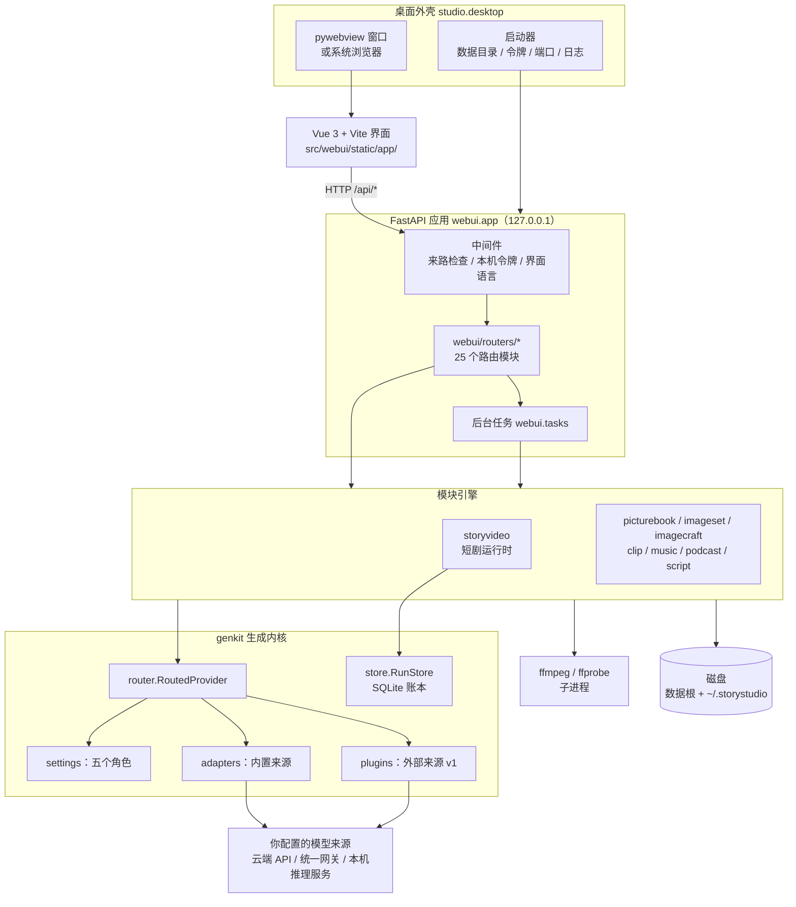
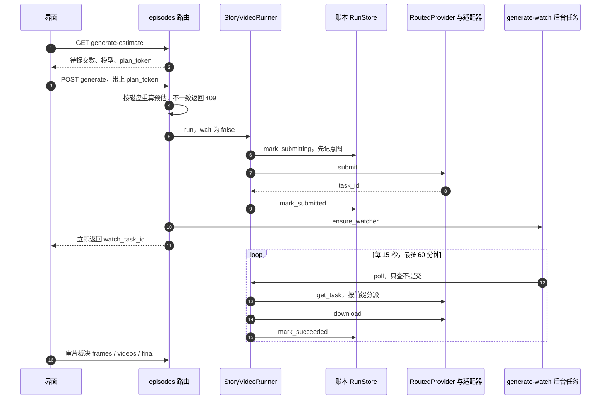

[English](../en/architecture.md) | 中文

# 技术架构

这篇文档讲 Content Cook 的代码是怎么搭起来的：进程与分层、源码地图、一次付费生成从点按钮到落盘的全过程、
数据怎么存、模型来源怎么抽象、提示词怎么编译、媒体怎么合成，以及安全、打包和测试。

- 想先把程序跑起来：看 [安装与部署](installation.md)。
- 想知道"为什么这样设计"：看 [设计理念与特点](design.md)。
- 想查设置项与环境变量：看 [配置参考](configuration.md)。
- 全部文档的索引：[docs/README.md](../README.md)。

本文对应 v0.1.0 的代码。更细的分层表在仓库根的 [ARCHITECTURE.md](../../ARCHITECTURE.md)，
逐条的设计记录在 [DESIGN.md](../../DESIGN.md)。

> **命名说明**：产品名是 **Content Cook · 内容创作工作台**，唯一来源是 `src/webui/branding.py`。
> pip 发行包名（`pyproject.toml` 的 `name`）是 `storystudio`，命令是 `storystudio` 和 `storyvideo`，
> 可导入的 Python 包是 `genkit`、`storyvideo`、`webui`、`studio` 等（见[第 2 节](#2-源码地图)），
> 桌面程序叫 `StoryStudio.exe`，设置目录是 `~/.storystudio`。这些是技术标识，刻意不跟产品名走。
> 以后改产品名，改 `branding.py` 里的常量，并同步几处副本：`desktop/installer.iss` 的默认 `AppName`、
> `desktop/storystudio.spec` 与 `src/studio/desktop.py` 里的兜底字面量、旧版页面 `src/webui/static/index.html` 的标题。
> 其中安装包、spec 和旧版页面这三处由 `tests/test_packaging_files.py` 核对。

## 目录

1. [总览](#1-总览)
2. [源码地图](#2-源码地图)
3. [启动流程](#3-启动流程)
4. [一次付费生成的生命周期](#4-一次付费生成的生命周期)
5. [持久化](#5-持久化)
6. [后台任务与断点续等](#6-后台任务与断点续等)
7. [模型来源抽象](#7-模型来源抽象)
8. [提示词编译](#8-提示词编译)
9. [媒体流水线](#9-媒体流水线)
10. [界面语言](#10-界面语言)
11. [安全架构](#11-安全架构)
12. [打包架构](#12-打包架构)
13. [测试策略](#13-测试策略)
14. [延伸阅读](#14-延伸阅读)

## 1. 总览

Content Cook 是一个单用户、在本机运行的程序。一个 Python 进程里跑着 FastAPI 服务（只绑 `127.0.0.1`），
界面是 Vue 写的单页应用，装在原生窗口（pywebview）或系统浏览器里，只通过 HTTP 与后端通信。
生成内容时，后端按「模型设置」里配置的来源去调用云端 API、统一网关或本机推理服务；
拼接、字幕、混音在本机用 ffmpeg 完成。项目文件和产物都存在本机磁盘上。



几条贯穿全局的约束：

- **界面只走 HTTP**：前端不依赖桌面壳的 JS 桥，业务规则和校验都在后端，所以外壳可以替换（DESIGN §8.1）。
- **生成请求只经 `genkit/adapters/`**：模块引擎只认 `genkit.providers` 里的请求与任务契约，不直接调用服务商 SDK。
  两处例外：音色库用 edge-tts 列音色表（`genkit/voices.py`）；起草的 `.env` 兜底直接请求 OpenAI 兼容的
  `/chat/completions`（`storyvideo/scriptgen.py`）。
- **出图、出片先说清再确认**：先给出请求次数与费用说明，确认后才提交；短剧还会在提交前先在账本记下"准备提交"，
  崩溃后不会悄悄重复提交。
- **产物从不覆盖**，删除先进回收站；只有在回收站里「彻底删除」才真正删掉（见 [5.5](#55-回收站)）。

### 分层

| 层 | 代码 | 职责 |
|---|---|---|
| 桌面外壳 | `src/studio/desktop.py` | 定数据目录、生成本机令牌、选端口、在后台线程起 uvicorn、开窗口；日志；打包版的 ffmpeg 路径 |
| 界面 | `frontend/` → `src/webui/static/app/` | 以资源为中心的工作台；hash 路由；只调 `/api/*` |
| Web 应用 | `src/webui/app.py`、`src/webui/routers/` | 两个 HTTP 中间件（`local_token_guard`：Host 与来路检查、本机令牌；`ui_language`：英文模式下翻译 `/api` 的 JSON）；约两百个接口按模块拆在 25 个路由文件里；后台任务 |
| 模块引擎 | `storyvideo`、`picturebook`、`imageset`、`imagecraft`、`clip`、`music`、`podcast`、`script` | 各模块的项目文件形状（spec）、静态检查、提示词编译、生成、装配 |
| 生成内核 | `src/genkit/` | 请求/任务契约、五个角色的设置、适配器与插件、路由、账本、能力表 |
| 外部依赖 | ffmpeg / ffprobe（子进程）；Pillow；可选的 faster-whisper（Python 库） | 音视频探测、合成、混音；图片后处理；台词识别 |

## 2. 源码地图

### `src/` 下的 Python 包

`pyproject.toml` 用 `[tool.setuptools.packages.find] where = ["src"]` 找包，测试用 `pythonpath = ["src"]`。

| 包 | 用途 | 主要文件 |
|---|---|---|
| `genkit` | 与服务商无关的生成内核 | `providers.py`（`ImageRequest` / `VideoRequest` / `MusicRequest`、`TaskSubmission` / `TaskSnapshot`、`GenerationProvider` 协议、通用下载）、`settings.py`（角色与来源表 `ADAPTERS`）、`adapters/`（内置来源、`REGISTRY`、`ASYNC_PREFIXES`）、`router.py`、`plugins.py` + `plugin_sdk.py`、`store.py`（账本）、`capabilities.py`、`model_catalog.py`、`local.py`（本机推理服务）、`voices.py`（音色库）、`trash.py`（回收站）、`ids.py`、`paths.py`、`logmask.py`、`version.py` |
| `storyvideo` | 短剧运行时与 `storyvideo` 命令行 | `spec.py`、`prompts.py` + `dialects.py`（编译）、`runtime.py`（`StoryVideoRunner`）、`state.py`（原子写 JSON）、`media.py`（ffprobe 校验）、`qc.py` / `asr_qc.py`（闸门）、`assembly.py`（成片装配）、`post_layers.py` + `segmented.py` + `subtitles.py`（后期）、`scriptgen.py` / `screenplay.py` / `series.py`（起草、剧本层、系列记忆）、`lint.py` / `continuity.py` / `preview.py`（静态检查）、`craft_review.py` / `genre_review.py`（模型审稿）、`poster.py`、`cli.py` |
| `webui` | FastAPI 应用 | `app.py`、`routers/`、`tasks.py`（后台任务）、`generate.py`（预估与后台轮询）、`revise.py`（制作中也能改）、`modules.py` + `branding.py`（模块注册表、产品名）、`i18n.py` + `i18n_rules.py`、`humanize.py` / `problems.py`（把内部文案变成人话和问题卡）、`export.py`（交付包）、`compare.py`（多模型首帧对比）、`uploads.py`（按字节嗅探上传格式） |
| `studio` | 桌面启动器，`storystudio` 命令的入口 | `desktop.py` |
| `picturebook` | 绘本 / 有声书 | `spec`、`lint`、`prompts`、`pages`（插画）、`narration`（朗读）、`timeline`、`assembly`、`scriptsheet`、`draft` |
| `imageset` | 图片集引擎，「图片工作台」「表情与头像」「纪念写真」三个模块共用 | `spec`、`templates`、`prompts`、`generate`、`post`、`export` |
| `imagecraft` | 出图风格卡、图像提示词方言、出图提示词检查 | `cards`、`dialects`、`lint` |
| `clip` | 单条视频 | `spec`、`prompts`、`lint`、`generate` |
| `music` | 配乐 | `spec`、`prompts`、`briefs`、`generate`、`use`（投放到其他模块） |
| `podcast` | AI 播客 | `spec`、`lint`、`craft`、`review`、`audio`、`export` |
| `script` | 剧本工作台 | `spec`、`lint`、`craft`、`review`、`use` |

模块注册表 `webui.modules.MODULES` 列出九个模块，`GET /api/modules` 把它交给界面：

| 模块 id | 界面路由 | 内容目录 | 引擎包 |
|---|---|---|---|
| `drama` 短剧 | `/drama` | `content/story_video` | `storyvideo` |
| `image` 图片工作台 | `/image` | `content/image` | `imageset` + `imagecraft` |
| `clip` 单条视频 | `/clip` | `content/clip` | `clip` |
| `picturebook` 绘本 / 有声书 | `/picturebook` | `content/picturebook` | `picturebook` |
| `sticker` 表情与头像 | `/sticker` | `content/sticker` | `imageset` |
| `portrait` 纪念写真 | `/portrait` | `content/portrait` | `imageset` |
| `music` 配乐 | `/music` | `content/music` | `music` |
| `podcast` AI 播客 | `/podcast` | `content/podcast` | `podcast` |
| `script` 剧本工作台 | `/script` | `content/script` | `script` |

### 仓库里的其他目录

| 目录 | 内容 |
|---|---|
| `frontend/` | Vue 3.5 + vue-router 5（hash 路由）+ Vite 8 的界面源码；`frontend/tests/` 下有 53 个 Vitest 测试文件。`npm run build` 输出到 `src/webui/static/app/`，构建产物随仓库提交 |
| `src/webui/static/` | 构建好的界面 `app/`（挂在 `/app`），以及旧版单页界面（`index.html` + `settings.js`，入口是 `/legacy`；没构建过新界面时 `/` 也退回它） |
| `desktop/` | 打包：`storystudio.spec`（PyInstaller）、`bundle_manifest.py`（随包文件白名单）、`verify_bundle.py`（打包后自检）、`build_windows.ps1`、`build_macos.sh`、`installer.iss`（Inno Setup）、`entitlements.plist`、图标 |
| `skills/` | 程序运行时读取的数据文件：镜头语言库、风格骨架、题材卡、形态卡、审稿清单、出图风格卡、配乐预设、ComfyUI 内置工作流。「镜头库与风格库」页面会改写其中的 `camera_library.json` 和 `style_library.json`，其余只读。不是 AI 助手的"技能"，见 [skills/README.md](../../skills/README.md) |
| `examples/` | 9 个示例项目，每个模块一个，界面上「从示例开始」由它们复制 |
| `tests/` | pytest 测试；`canary/` 是提示词黄金样本；`fixtures/adapters/` 是 13 份适配器回放夹具；`fixtures/plugins/` 是测试用的假插件 |
| `scripts/` | `refresh_prompt_canary.py`：提示词金丝雀 |
| `docs/` | 文档和各模块的契约（spec） |

### 三个根目录

| 根 | 怎么定 | 放什么 |
|---|---|---|
| 代码资源根 `genkit.paths.code_root()` | 源码运行时是仓库根；打包版是 PyInstaller 的资源目录（`sys._MEIPASS`） | `skills/`、`examples/`、界面静态文件 |
| 用户数据根 `genkit.paths.data_root()` | 环境变量 `STORYSTUDIO_PROJECT_ROOT`；没设时退回代码资源根。桌面启动器每次启动都会把它设好 | 项目文件、产物、账本、后台任务记录、回收站 |
| 用户主目录 | `STORYSTUDIO_HOME`，默认 `~/.storystudio` | 设置、日志、缓存、音色库、插件、打包版的可选组件 |

`skills/` 和 `examples/` 从代码资源根读取，不在 wheel 里，所以目前只支持从克隆的仓库做可编辑安装
（`pip install -e`），详见 [安装与部署](installation.md)。

## 3. 启动流程

`storystudio` 命令（`studio.desktop:main`）按这个顺序做事：

1. 解析参数（`--port`、`--browser`、`--no-open`、`--no-token`、`--project-root`、`--no-plugins`、`--version`）。
2. 配日志：`<主目录>/logs/storystudio.log`，按 2,000,000 字节滚动、保留 3 份，写之前先脱敏。
3. 打包版把程序目录、`ffmpeg/`、`ffmpeg/bin/`（存在的才加）放到 `PATH` 最前面。
4. 定数据根：`--project-root` > `STORYSTUDIO_PROJECT_ROOT` > 打包版的 `~/StoryStudio` > 当前目录，并写回环境变量。
5. 打包版把可选组件目录（默认 `~/.storystudio/site-packages`）接进 `sys.path`，用于台词识别。
6. 加载插件（`--no-plugins` 时跳过）。插件怎么出错都只记日志，不拦启动。
7. 切到数据根，建好 `content/story_video/` 和 `output/`。
8. 生成本机访问令牌（`--no-token` 时不生成，并打印警告）。
9. 选端口：先试 8756，再试 8757–8799；指定的 `--port` 已被占用时给出一个可用的端口（Windows 上还会指出是哪个进程占的），
   退出码 2。
10. 在后台线程里起 uvicorn，只绑 `127.0.0.1`。
11. 最多等 30 秒，轮询 `/api/health` 并确认应答的是本程序；是别的程序、服务线程挂了或超时，都说明原因后退出（退出码 1）。
12. 打开 pywebview 窗口；没装 pywebview 时退回系统浏览器；`--no-open` 只跑服务，直到 Ctrl+C。

FastAPI 应用自己的 `lifespan` 在服务起来时再做两件事：确认插件已加载（直接用 `uvicorn webui.app:app`
起服务、不经过启动器时也生效），然后恢复上次退出时还在服务商那边的任务（见 [第 6 节](#6-后台任务与断点续等)）。

## 4. 一次付费生成的生命周期

短剧是链路最长的模块，下面以它为例。其他模块走的是简化版，见本节末尾。



### 4.1 预估（只读，不花钱）

`GET /api/episodes/storyvideo/{id}/generate-estimate?through=frames|videos[&only=S1,S2]` 调用
`webui.generate.estimate_plan`，逐镜给出：产物是否已有、账本里的状态（在飞、失败、被"重摇"重置）、
用哪个模型、视频时长、缺哪些上游首帧。来源是本机推理服务时，`cost_note` 写明"不花钱"。

返回里的 `plan_token` 是对"项目 id、阶段、待提交的镜、模型集合"做的哈希。
项目文件、账本和冻结快照对不上时，预估直接返回 409——先说清要处理什么，而不是先弹花钱确认框。

### 4.2 确认与提交

界面弹出确认框，写明这次要新提交几个请求。确认后
`POST /api/episodes/storyvideo/{id}/generate`（带 `plan_token`）：

1. 按磁盘现状重算一次预估，`plan_token` 不一致返回 409，什么都没提交。
2. 检查这次需要的角色有没有配好（首帧要生图角色；视频要视频角色，缺上游首帧时还要生图角色），没配返回 400。
3. 调用 `StoryVideoRunner.run(wait=False)`。它持有项目的文件锁 `manifests/production.lock`，
   另一个进程或另一次点击不能同时生产同一个项目。

runner 里面依次是：

- `prepare`：第一次时把 spec 冻结成 `manifests/episode.snapshot.json`，之后每次都核对有没有被改过。
- 账本里有"提交结果不明"的任务时先尝试自动对账，对不上就把项目标成 `blocked_submission_unknown` 并停下。
- 先把已经提交出去的远端任务查完、下载完，再考虑提交新的。
- 提交任何新任务之前先做本机装配预检（`storyvideo.assembly.preflight_assembly`）：找不到 ffmpeg、ffprobe
  或可用的字幕字体就直接报错（接口返回 400），一个请求都不发。只出首帧时也会检查。
- 按闸门推进：首帧没过审就只做首帧这一波；首帧过审后才做视频这一波。
- 每一步提交：上传依赖（参考图等，实际只登记成本地令牌 `local:<路径>`）→ 编译请求 →
  `mark_submitting`（同时记下真实使用的来源和模型）→ `provider.submit` → `mark_submitted`（记下 task_id）。

提交出错时的归类决定了之后能不能安全重试：

| 情况 | 账本里记成 | 之后 |
|---|---|---|
| 角色没配、缺密钥（`ProviderNotConfigured`） | `failed` | 配好后可原地重提 |
| 服务商明确拒绝、不可用、额度用完 | `failed`（额度问题把项目标成 `blocked_quota`） | 可重提 |
| 其他异常（例如网络中断，不知道对方收没收到） | 项目标成 `blocked_submission_unknown` | 不会自动重提，需要对账（见 [STORYVIDEO_RUNTIME.md §6](../../STORYVIDEO_RUNTIME.md#6-崩溃恢复与避免重复扣费)） |

接口的错误码：计划过期，或项目状态不允许（包括「提交结果不明」被拦下）返回 409；前置闸门没过返回 425；
输入错误、角色没配、本机预检失败或服务商拒绝了提交返回 400。

### 4.3 路由与任务 id

`genkit.router.RoutedProvider` 是 runner 眼里唯一的 provider。它按请求类型找到对应角色的适配器；
适配器返回的任务 id 有下面几种形式，`get_task` 按形式分派：

| 任务 id | 来自 | `get_task` 怎么查 |
|---|---|---|
| `file:<路径>` | 同步来源，结果已存进缓存目录 | 直接算完成，给出 `file://` 地址（缓存文件不见了则记失败） |
| `url:<地址>` | 同步来源，服务商给了结果地址 | 直接算完成 |
| `openrouter:` / `ark:` / `minimax:` / `oaivid:` / `comfy:` 开头 | 内置异步来源（`openrouter_video` / `ark_video` / `minimax_video` / `openai_video` / `comfyui`） | 交给提交它的适配器；如果这个角色现在配的是别的来源，直接报错并建议切回原来源或重拍，不拿新来源的凭据去查 |
| 插件登记的前缀 | 插件提供的来源 | 插件没加载时抛 `ProviderUnavailable`，任务留在"等远端"，不记失败；装好插件重启后接着查 |

前缀表在 `genkit.adapters.ASYNC_PREFIXES`，插件通过 `add_async_prefix` 往里登记。

### 4.4 后台轮询、下载与记账

`generate` 接口提交完立即返回，同时通过 `ensure_watcher` 起一个 `generate-watch` 后台任务：

- 每 15 秒调一次 `runner.poll()`。`poll` 只查进度、下载、记账，**不提交新任务，不花钱**。
- 任务完成后下载结果：默认上限 512 MiB、超时 120 秒，先下载成旁边的候选文件；
  用 ffprobe 校验（能解码、大小达标，视频还要核对时长和音轨），在 `manifests/installs/` 写一份带 sha256 的安装标记，
  再原子替换成正式文件，最后 `mark_succeeded` 记下产物路径。
- 没有在飞的任务就结束；最多等 60 分钟；同一条错误连续出现 3 次也停下，原因写进任务记录。

### 4.5 审片闸门

短剧有三道人工闸门：`frames`（首帧）、`videos`（视频）、`final`（成片），另有自动的技术检查。
裁决有 `pass`、`retake`、`edit_rescue`、`redesign`、`waive` 五种，存在 `manifests/qc.json`；
文件字节变了，旧裁决自动失效。首帧没过审不能提交视频，视频没全部过审不能装配。
可选的台词识别闸（faster-whisper）按字错率判断：≤ 0.30 通过，0.30–0.45 需要人耳复核。

装配成片是纯本机 ffmpeg，不调用任何付费接口。后期合成的拼接与混音也在本机，但旁白和台词配音要先用 TTS 合成：
走「模型设置」里的语音角色（可能收费）、音色库里克隆的 MiniMax 音色，或 edge-tts（微软的免费在线服务）；
旁白里同一句文本和声线合成过，就复用缓存的 mp3（`storyvideo.post_layers.render_vo_lines`）。
完整的命令行流程见 [STORYVIDEO_RUNTIME.md](../../STORYVIDEO_RUNTIME.md)。

### 4.6 其他模块

单条视频、图片集（图片工作台 / 表情与头像 / 纪念写真）、配乐、绘本插画的生成更简单：

- 界面先弹确认框，写明请求次数与费用说明（本机来源写"不花钱"），然后起一个该模块的后台任务
  （例如 `clip-generate`、`music-generate`）。
- 任务里逐条提交；异步来源在任务内轮询（单条视频每条最多等 45 分钟，图片、配乐、绘本插画每条最多 20 分钟）。
- 请求哈希不变且产物还在就跳过，除非强制重出。
- 每次尝试追加进项目文件（或绘本的 `manifests/pages.json`），逐条原子写盘。
  这些模块不用 SQLite 账本——**账本只属于短剧**。

## 5. 持久化

### 5.1 数据根里有什么

```text
<数据根>/
├── content/
│   ├── story_video/<ID>.json              短剧项目文件（spec）
│   ├── story_video/<ID>.screenplay.json   剧本层
│   ├── series/<series_id>.json            系列记忆
│   ├── <模块>/<id>.json                   image / clip / picturebook / sticker / portrait / music / podcast / script
│   └── assets/<id>/                       上传的参考图、音频
├── output/
│   ├── story_video/storyvideo.sqlite3     短剧账本（SQLite，WAL 模式）
│   ├── story_video/<ID>/                  01_frames/ 02_video/ manifests/ <ID>_final.mp4 <ID>_post.mp4
│   └── <模块>/<id>/                       其他模块的产物
├── .webui_draft_cache/                    jobs/（起草记录）、tasks/（后台任务记录），都不删除
├── .webui_deleted/                        回收站
├── local_workflows/                       你自己的 ComfyUI 工作流 + 同名 .map.json
└── .env                                   可选：起草用的 SCRIPTGEN_* 兜底配置
```

用户主目录（默认 `~/.storystudio`）：

```text
~/.storystudio/
├── settings.json          角色、密钥、网关等设置（STORYSTUDIO_SETTINGS 可以把它挪到别处）
├── settings.json.lock     跨进程锁
├── cache/                 同步来源的结果缓存（设置项 cache_dir 可改）
├── logs/storystudio.log   滚动日志（已脱敏）
├── voices.json, voices/   音色库
├── model_catalog.json     模型目录缓存
├── plugins/<名字>/         插件
└── site-packages/         打包版的可选组件
```

各项的含义与可改的环境变量见 [配置参考](configuration.md)。

### 5.2 项目文件与冻结

项目文件就是 JSON spec，界面和命令行读写的是同一份。短剧在 `prepare` 时冻结：
快照写进 `manifests/episode.snapshot.json`，之后每次生产前都比对哈希。改动分三类：

- 只改后期块（字幕、旁白、画面文字等，不进付费请求）：用 `amend`，不用开新版本。
- 平台临时失败：用 `retry-failed` 原地重提。
- 改到会进提示词或参数的字段：必须开新版本（revision）。界面的「制作中也能改」（`webui.revise`）会逐镜比较
  编译后的请求，算出哪些镜作废（参考链会传染），把还能用的产物和审片裁决复制到新版本，只重出受影响的镜。

### 5.3 账本（RunStore）

`genkit.store.RunStore` 是一本 SQLite 账本，开 WAL 模式，线程之间和进程之间都可以安全共用。

| 表 | 主要列 |
|---|---|
| `runs` | `run_id`、`input_hash`、`plan_hash`、`run_dir`、`status`、时间戳 |
| `jobs` | 主键 `(run_id, step_id)`；`kind`、`request_hash`、`output_path`、`status`、`attempt`、`task_id`、`remote_state`、`result_url`、`asset_id`、`artifact_path`、`error`、`provider`、`model`、各阶段时间戳 |

- `(kind, task_id)` 上有唯一索引，同一个远端任务不会被两条记录认领。
- 表结构版本记在 `PRAGMA user_version`，当前是 2。可写打开时逐步迁移；只读打开不迁移；
  遇到比程序更新的账本直接拒绝打开，不会误写。
- 同一个 id 换了输入再提交，会被拒绝（"already has different inputs"），不会覆盖已付费的记录。

### 5.4 原子写与从不覆盖

- 项目文件和大部分状态 JSON 用 `storyvideo.state.atomic_write_json`：同目录临时文件 → `fsync` → `os.replace`。
  设置、音色库、回收站的 manifest、系列记忆、审片裁决等各自也走「临时文件 + 替换」；
  少数辅助记录（如台词识别报告、旁白清单、交付包里的清单）是直接写入的。
- 设置文件另加进程内锁和跨进程锁（`settings.json.lock`），并发修改会合并；
  读不出来的设置文件在下次保存时改名为 `settings.json.broken-<时间戳>` 留作备份；
  保存后收紧权限（chmod 600，Windows 上用 icacls 只给当前用户）。
- 下载、成片、绘本和播客的最终输出都先写临时文件，核对后再原子替换。
- 生成的产物按序号追加、从不覆盖，例如单条视频的 `01_video/<ID>-<n>.mp4`、图片集的 `01_raw/<item>-<n>.png`、
  配乐的 `01_raw/<ID>-<n>.<ext>`、绘本的 `05_pages/P01-<attempt>.png`；项目文件里的 `current` 指向采用的那一条。
  失败只记原因，不替换上一份能用的产物。

### 5.5 回收站

删除从来不是 `os.remove`。`genkit.trash` 把项目文件、`output/<模块>/<id>/`、`content/assets/<id>/`
一起搬进 `.webui_deleted/<模块>/<id>__<UTC 时间>/`，并写一份 `manifest.json`。
恢复时按固定布局放回原位（不信任 manifest 里记的路径），全部成功或全部不动，也不覆盖同名文件。
文件被占用或有任务在跑时拒绝删除。短剧的归档还带上剧本层和账本行。
回收站页也可以「彻底删除」某条归档（`genkit.trash.purge`，界面上要二次确认），这一步不可恢复。

## 6. 后台任务与断点续等

长任务（起草、审稿、台词识别、后期合成、出图、出片、配音、装配等）不用阻塞的 HTTP 请求硬扛：

- `webui.tasks.start(kind, episode_id, fn, *, params=None, module=…)` 在守护线程里执行，立即返回 `task_id`
  （参数名叫 `episode_id`，实际就是各模块的项目 id）。
- 记录写在 `<数据根>/.webui_draft_cache/tasks/<task_id>.json`（原子写，从不删除），
  状态是 `pending` / `running` / `succeeded` / `failed`。
- 同一个项目、同一种任务同一时间只允许一个；重复点击直接拒绝（409），而不是排队。
- 界面轮询 `GET /api/tasks/{task_id}`；任务中心用 `GET /api/tasks` 列出全部任务。
- 短剧的 AI 起草与单镜重写，每次结果另存在 `.webui_draft_cache/jobs/`，不覆盖、不删除，相当于版本历史。

任务都是服务进程里的线程，关掉程序就停了。已经提交给服务商的任务靠启动时的续等找回：

- 服务起来时 `resume_inflight_watchers()` 扫短剧账本，给有在飞任务的项目重新起 `generate-watch`；
  再扫 `content/clip/`，把已拿到 task_id、还没取回结果的单条视频接着等。
- 续等只查进度和下载，从不提交。短剧也可以手动调用 `POST /api/episodes/storyvideo/{id}/generate-resume`。
- 目前自动续等只覆盖短剧和单条视频。

## 7. 模型来源抽象

### 7.1 角色与来源

模型按"角色"配置，每个角色选一个来源（适配器），字段是 `adapter`、`base_url`、`api_key`、`model`、`voice`、`extra`。
留空的字段用来源自己的默认值。

| 角色 | 用途 | 内置来源 id |
|---|---|---|
| `text` | 剧本、起草、审稿 | `openai_chat` |
| `image` | 首帧、插画、图片 | `openrouter_images`、`openai_images`、`ark_images`、`sdwebui`、`comfyui` |
| `voice` | 配音、旁白、朗读 | `openrouter_tts`、`edge_tts`、`openai_speech`、`minimax_speech` |
| `video` | 视频 | `openrouter_video`、`ark_video`、`minimax_video`、`openai_video`、`comfyui` |
| `music` | 配乐 | 无内置来源，需要插件 |

每个来源的字段与默认值见 [配置参考](configuration.md)。

### 7.2 适配器约定

- 一个适配器一个文件，放在 `src/genkit/adapters/`。方法按角色实现：
  `submit_image`、`submit_video`、`submit_music`、`get_task`、`synthesize`（语音）、`complete_json`（文本），
  外加「测试连接」用的 `ping`。
- **每个方法只做一次远端操作**。轮询、重试、持久化都归 runner 或模块的任务，不归适配器。
- 同步接口用 `store_result` 把结果存进缓存，返回 `file:` 任务 id；异步接口返回带自己前缀的远端 id。
- 参考图不单独上传：路由返回 `local:<路径>` 令牌，适配器提交时把它编码成 base64 / data URL。
- 优先用官方 SDK（`openai`、`openrouter`、`volcengine-python-sdk`、`edge-tts`）；
  没有 SDK 的才手写 HTTP（MiniMax、SD WebUI、ComfyUI；`openai_video` 也走 REST）。
- 两张表必须对得上：`settings.ADAPTERS`（界面表单：标签、字段、提示、默认值）和
  `adapters.REGISTRY`（构造函数）。`tests/test_genkit.py` 里有测试守着。

### 7.3 路由

`RoutedProvider` 按角色懒加载适配器，并负责：

- 提交前的本地预检 `preflight`：角色没配就抛 `ProviderNotConfigured`，一次请求都不发，账本里一笔都不记。
- `submission_source`：解析 spec 里的 `@image` / `@video` 别名（表示"用该角色设置里的模型"），
  把真实的来源和模型记进账本。spec 里写了具体模型 id 时以 spec 为准。
- `get_task` 按任务 id 前缀分派（见 [4.3](#43-路由与任务-id)）。

### 7.4 能力表与模型目录

- `genkit.capabilities` 是一张静态表：`(角色, 来源, 模型前缀)` → 参数范围（画幅、尺寸档、时长、参考图张数等）。
  开始制作前用它检查 spec。条目分两档：`verified` 的越界当错误拦，`doc`（照服务商公开文档整理）的只提醒。
  档位只是表里的标记，不代表本版本用各家直连密钥联调过（见[第 13 节](#13-测试策略)）。
  分辨率会自动对齐到最近的支持档位。
- `genkit.model_catalog` 在用户点「拉取」时才联网，拿 OpenRouter 公开列表或网关的 `/models`，
  缓存到 `~/.storystudio/model_catalog.json`，只作参考。

### 7.5 统一网关

如果你用 LiteLLM、new-api、one-api 这类网关，填一次地址和密钥，就可以把 text / image / voice / video
四个角色一起切到 `openai_chat` / `openai_images` / `openai_speech` / `openai_video`（配乐不在内）。
应用之后，角色配置仍是运行时唯一读取的东西，网关只是一次性的填表助手。

### 7.6 本机模型

`GET /api/system/local-scan` 探测常见的本机推理服务：Ollama、LM Studio、vLLM、llama.cpp server（文本），
ComfyUI（图片与视频），SD WebUI / Forge（图片），以及 Kokoro-FastAPI 这类 OpenAI 兼容语音服务。
它只连接本机和私有网段地址，不是网络扫描器。用本机来源时不需要密钥，确认框写"不花钱"。
设计契约见 [docs/local-models-spec.md](../local-models-spec.md)。

### 7.7 插件（接口 v1，实验性）

不想改核心的来源写成插件：放在 `~/.storystudio/plugins/<名字>/`，或用 `STORYSTUDIO_PLUGIN_PATH` 指定目录。
插件声明 `STORYSTUDIO_API = 1`，在 `register(api)` 里调用 `add_adapter`、`add_async_prefix`、`add_capabilities`、
`add_i18n`、`add_failure_hints` 登记自己；实现只从 `genkit.plugin_sdk` 导入。登记是原子的，加载失败时
这个插件整体不生效，程序照常启动，原因显示在设置页和 `/api/health`。
插件以你的用户权限运行，只装你信任的插件。完整接口见 [docs/plugins.md](../plugins.md)，
可运行的示例在 `tests/fixtures/plugins/example_async/`（离线假来源）。

## 8. 提示词编译

提示词不是手写的一段话，而是从结构化的 spec 编译出来的：

- **短剧**：`storyvideo.prompts` 的 `compile_frame_prompt` / `compile_video_prompt` / `compile_negative_prompt`
  结合镜头语言库 `skills/ai-short-film/scripts/camera_library.json`，把镜头事实（入口/出口状态、节拍、表演锁、
  视觉风格、形态卡、连续性锁等，均为可选字段）编成首帧与视频请求。风格骨架 `style_library.json` 用于起草时的指导。
  提示词语言可选中文或英文。
- **视频方言**（`storyvideo.dialects`）：`generic`（默认）、`minimax-h3`、`seedance`。
  `video_params.prompt_dialect` 写 `auto` 时按生效的视频模型自动选。
- **图像方言**（`imagecraft.dialects`）：`generic`（默认）、`gpt_image`、`nano_banana`，按模型 id 或显式设置选。
- 其他模块（单条视频、图片集、绘本、配乐）各有自己的 `prompts.py`，契约见 `docs/*-spec.md`。

编译结果进 `request_hash`。编译器或镜头库的任何改动都会改变哈希，已冻结的短剧会拒绝"输入变了"的提交。
所以有一道**提示词金丝雀**：

```bash
python scripts/refresh_prompt_canary.py           # 只比对，有漂移就非零退出
python scripts/refresh_prompt_canary.py --update  # 确认是有意改动后，接受新的黄金样本
```

它把 `tests/canary/mini_spec.json`（再加每张形态卡 × 中英文）编译一遍，和 `tests/canary/expected_prompts.json` 比对。
CI 每次都跑；改 `prompts.py`、镜头库、风格库前后都要跑（见 [AGENTS.md](../../AGENTS.md)）。
方言目前没有和真实模型做过对照测试。

## 9. 媒体流水线

音视频的探测、合成与混音都通过子进程调用 `ffmpeg` / `ffprobe`（在 `PATH` 里查找），不用 ffmpeg 的 Python 绑定。
图片后处理（表情尺寸、透明底、图卡叠字、海报、角标）用 Pillow；台词识别由 faster-whisper 自己读取音频。

| 用途 | 做法 |
|---|---|
| 校验产物 | ffprobe 读流信息：可解码、时长容差、音轨等，用于技术 QC |
| 短剧成片装配 | 拼接各镜（可选交叉溶解），`loudnorm=I=-16:TP=-1.5:LRA=9` |
| 短剧后期合成 | 旁白、台词配音、插卡、画面文字、配乐、字幕；分段流式合成后整体做响度归一 |
| 绘本 / 有声书 | 先混全书声音，再按 24 fps 帧网格逐页出片，最后流复制拼接；`loudnorm=I=-14:TP=-2:LRA=11` |
| 播客 | 逐句配音铺时间线，垫乐与闪避，`loudnorm` 目标 −16 LUFS、真峰值 −1.5 dBTP，输出 mp3 |
| 字幕 | 用 ffmpeg 的 `drawtext` 烧进画面；样式在 `storyvideo.subtitles`，需要本机有中文字体 |

为了在普通内存的机器上也能出长片，渲染是分段的（改动记录在 [CHANGELOG.md](../../CHANGELOG.md)）：

- 短剧后期以前把整片塞进一条 ffmpeg 命令，内存随镜数增长（CHANGELOG 里有数字）；现在逐项归一化、分组拼接，
  内存被组大小封顶，与镜数无关。
- 绘本以前全书一条 xfade 链（40 页 7.4 GB），现在逐页出片再拼接（降到 2.3 GB）。
- 超过 64 路的音频先分组预混（`storyvideo.segmented.MIX_GROUP`），避开 Windows 32767 字符的命令行上限；
  中间文件用 32 位浮点 WavPack，保证分组相加不削顶。
- 最终输出都先写临时文件，核过再原子替换。

字体查找顺序、ffmpeg 缺失时的提示见 [安装与部署](installation.md) 和 [常见问题](faq.md)。

## 10. 界面语言

- 界面有中文（源文案）和英文两种，切换入口在侧栏底部。前端以中文字符串为键，英文放在 `frontend/src/locales/`；
  选择存在 `localStorage` 的 `storystudio_lang`，默认按浏览器语言（`zh*` 用中文，其余用英文），
  缺翻译时显示中文。
- 前端每个请求带 `X-StoryStudio-Lang` 头（没有时后端看 `Accept-Language`）。
- 后端的 `ui_language` 中间件在英文模式下，把 `/api/*` JSON 响应里用户可见的文案按 `src/webui/i18n_rules.py`
  的精确表与正则模板翻译。插件可以用 `add_i18n` 补自己的文案（正则必须带 `^...$` 锚点）。

## 11. 安全架构

威胁模型是"单用户、本机"：防的是同一台机器上的其他进程和浏览器里的其他网页，而不是多用户权限。

| 机制 | 说明 |
|---|---|
| 只绑回环地址 | uvicorn 固定绑 `127.0.0.1`，不支持远程或局域网访问 |
| Host 检查 | Host 不是 `127.0.0.1` / `localhost` / `::1` 的请求返回 403，防 DNS rebinding（源码运行时另外放行测试客户端用的 `testserver`，打包版不放行） |
| 来路检查 | `/api/*` 请求如果 `Sec-Fetch-Site` 是 `cross-site` / `same-site`，或 `Origin` 不对，返回 403 |
| 本机令牌 | 每次启动随机生成；打开 `/?token=…` 时种下 `storystudio_token_<端口>` cookie（HttpOnly、SameSite=Strict）；`/api/*` 必须带这个 cookie 或 `X-StoryStudio-Token` 头，否则 401；常量时间比较 |
| 接口文档 | `/docs`、`/redoc`、`/openapi.json` 在打包版里不挂载，开发态在令牌后面 |
| 密钥 | 程序只把密钥写进设置文件（默认 `~/.storystudio/settings.json`，`STORYSTUDIO_SETTINGS` 可改位置），保存后收紧文件权限；接口只返回打码后的密钥；换来源，或把地址改到另一个源（协议、主机或端口不同）又没填新密钥时，旧密钥自动清空。另有两处可以提供密钥，程序只读不写：环境变量 `STORYSTUDIO_<角色>_API_KEY`，以及起草兜底用的 `SCRIPTGEN_LLM_API_KEY`（环境变量或数据根里的 `.env`） |
| 日志脱敏 | 日志（`genkit.logmask`）：常见密钥格式、Bearer、URL 里的 key/token 参数、data URL 的 base64 都会被遮掉；失败的后台任务记录落盘前也过一遍。日志里的本机路径不做替换，分享日志前请自己检查 |
| 报错里的路径 | 读项目文件出错、插件加载出错时，返回给界面的报错把数据根写成 `<数据目录>`、主目录写成 `~`（`webui.deps.redact_local_paths`、`genkit.plugins.portable_text`）；不是所有报错都经过这一步 |
| 数据边界 | spec 里引用的路径（输出目录、参考图、参考音频、音乐）限制在数据根内；id 校验；上传按字节嗅探真实格式；ffmpeg 滤镜文本转义 |
| 插件 | 只从主目录的 plugins 目录和 `STORYSTUDIO_PLUGIN_PATH` 加载，从不从项目数据目录、设置文件或程序目录加载 |

程序本身没有遥测。会发出网络请求的只有：

- 你配置的模型来源（音色库的「克隆」会把参考录音上传给 MiniMax）；
- 使用 edge-tts 时的微软在线语音（合成和列音色表）；
- 你主动触发的操作：拉取模型目录；检查更新（只有在设置里填了更新清单地址 `update_url` 才会查，默认不填）；
  一键安装台词识别组件（用 pip 下载，默认来自 PyPI）；第一次跑台词识别或预下载模型（从 Hugging Face 下载模型）。

另有两处页面会加载外部资源：旧版界面 `/legacy`（项目「高级」页有链接）从 Google Fonts 拉字体；
源码运行时的接口文档页 `/docs`、`/redoc` 从 CDN 加载脚本（打包版不挂这两个页面）。

发布前做过一次安全自查，结果见 [docs/security-review-2026-09-23.md](../security-review-2026-09-23.md)。
报告漏洞请按 [SECURITY.md](../../SECURITY.md) 的方式。

## 12. 打包架构

桌面版用 PyInstaller 打成一个文件夹（one-folder），详细步骤见 [desktop/README.md](../../desktop/README.md)
和 [安装与部署](installation.md)。

- `desktop/storystudio.spec`：入口 `src/studio/desktop.py`，输出 `dist/StoryStudio/`（`StoryStudio.exe` + `_internal/`），
  无控制台窗口，不用 UPX。排除了 tkinter、faster-whisper、torch、ctranslate2、onnxruntime、numpy 等体积大的可选依赖。
- **随包文件白名单** `desktop/bundle_manifest.py`：`skills/`、`examples/` 里要带的文件逐个列出，
  外加许可文件（`LICENSE`、`docs/third-party-notices.md`）和界面静态文件。spec、打包自检和测试共用这一份清单。
- **打包后自检** `desktop/verify_bundle.py`：包里出现测试框架、白名单外的数据、本机数据（`.env`、`settings.json`、
  数据库、日志、`content/`、`output/` 等）、插件或打包机的绝对路径，都会让它失败。
- **可选组件**：打包版不带 faster-whisper。应用内「一键安装」借用本机同版本的 Python 执行
  `pip install --target ~/.storystudio/site-packages faster-whisper`，启动器下次启动时接进 `sys.path`。
- **ffmpeg**：默认不随包。打包前把 `ffmpeg.exe` / `ffprobe.exe` 放进 `desktop/ffmpeg/`，安装包会把它们装到程序目录的 `ffmpeg/` 下（注意 ffmpeg 的许可证）。
- **安装包**：`desktop/installer.iss`（Inno Setup 6）用来生成 Windows 安装程序；按脚本配置，卸载只删程序文件，
  不碰 `~/StoryStudio` 和 `~/.storystudio`。这一步只在 CI 的打包任务里跑，而 CI 还没实际运行过，
  所以安装包本身尚未验证；exe 和安装包都没有签名（签名方法见 [desktop/README.md](../../desktop/README.md)）。
- **macOS**：spec 里有 `.app` 的 BUNDLE 配置，`desktop/build_macos.sh` 负责签名、公证和打 dmg，
  但**从未在 Mac 上实际跑过**。
- 打包版的代码资源根在程序目录里，所以「镜头库与风格库」页面会把 JSON 写进程序目录：装在 Program Files 下时
  可能没有写权限，写进去的改动重装时也会被覆盖。这条路径没有实际验证过。

## 13. 测试策略

| 层 | 工具与规模 | 说明 |
|---|---|---|
| 后端 | pytest，`tests/` 下 142 个测试文件，约 3,200 个用例 | `pytest -q` 运行；缺 ffmpeg / ffprobe 或中文字体时，媒体相关测试会跳过 |
| 适配器契约 | `tests/test_adapter_contracts.py` + `tests/fixtures/adapters/*.json` | 用假 SDK / 假 HTTP 回放 13 份按公开文档手写的响应，检查提交、查询、结果地址、参考图编码，全程不联网 |
| 插件 | `tests/test_plugins.py` + `tests/fixtures/plugins/` | `conftest.py` 默认关闭插件（`STORYSTUDIO_PLUGINS=off`），测试里显式加载假插件，测完撤回 |
| 提示词 | `scripts/refresh_prompt_canary.py` | 编译结果与黄金样本逐字比对 |
| 打包 | `tests/test_packaging_files.py`、`tests/test_desktop_launcher.py` | 白名单、版本号读取、sdist 内容、启动器行为；不需要真的装 Inno Setup 或 Mac |
| 前端 | Vitest + @vue/test-utils + jsdom，`frontend/tests/` 下 53 个测试文件 | `npm test` 运行 |

CI（`.github/workflows/ci.yml`）在 Ubuntu 和 Windows 上用 Python 3.11 跑 pytest 与金丝雀；用 Node 22 跑 Vitest 并构建前端，
构建结果和仓库里提交的 `src/webui/static/app/` 不一致就失败；打 `v*` 标签或手动触发时再打 Windows 包并做冒烟测试。
截至 v0.1.0，这份工作流还没有在 GitHub 上实际运行过。

需要说清楚的限制：

- 用真实模型完整走通的只有播客流程（文本模型经 OpenAI 兼容接口 + edge-tts）。内置适配器只用回放夹具和假客户端测过，
  各家直连密钥都没有真实联调过。
- 一部完整长度短剧的端到端出片与后期合成还没验证过；音色克隆、打包版里的台词识别与后期合成也没验证过。
- Windows 安装包（Inno Setup）只在 CI 里构建，而 CI 还没运行过；exe 与安装包都没有签名。
  macOS 打包从未执行；没有 Linux 的打包脚本，Linux 上的 pytest 只写在还没运行过的 CI 里。
- 本机模型没有在真实硬件上验证过。`pyproject.toml` 要求 Python 3.10 及以上，但只在 3.11 上跑过，3.10 和 3.12+ 没测过。
- 详见 [CHANGELOG.md](../../CHANGELOG.md) 的「已验证 / 未验证」和 [BACKLOG.md](../../BACKLOG.md)。

贡献代码时怎么跑这些测试，见 [贡献指南](../../CONTRIBUTING.zh-CN.md)。

## 14. 延伸阅读

| 文档 | 内容 |
|---|---|
| [ARCHITECTURE.md](../../ARCHITECTURE.md) | 逐层职责表、"新增一个模型来源"的步骤 |
| [DESIGN.md](../../DESIGN.md) | 产品原则与每一条设计决策的记录（按编号） |
| [STORYVIDEO_RUNTIME.md](../../STORYVIDEO_RUNTIME.md) | 短剧命令行手册：spec、生产流程、闸门、重摇、崩溃恢复、产物布局 |
| [AGENTS.md](../../AGENTS.md) | 改代码的规矩 |
| [docs/plugins.md](../plugins.md) | 插件接口 v1 |
| [docs/local-models-spec.md](../local-models-spec.md) | 本机模型 |
| [docs/clip-spec.md](../clip-spec.md)、[docs/imageset-spec.md](../imageset-spec.md)、[docs/imagestudio-spec.md](../imagestudio-spec.md)、[docs/picturebook-spec.md](../picturebook-spec.md)、[docs/music-spec.md](../music-spec.md)、[docs/podcast-spec.md](../podcast-spec.md)、[docs/scriptlab-spec.md](../scriptlab-spec.md) | 各模块的契约 |
| [docs/image-style-cards.md](../image-style-cards.md)、[docs/prompt-patterns.md](../prompt-patterns.md) | 出图风格卡、提示词写法 |
| [desktop/README.md](../../desktop/README.md) | 打包细节 |

上面这些深入文档目前只有中文版。
